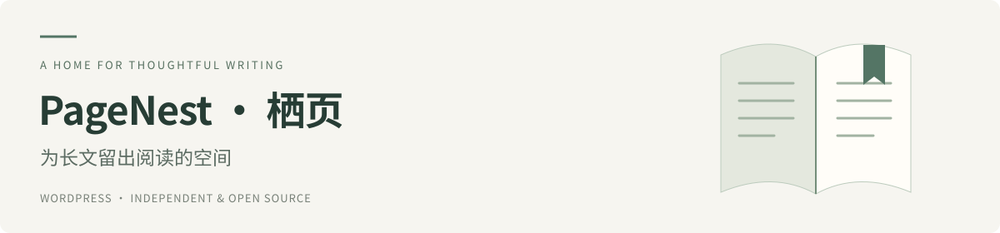
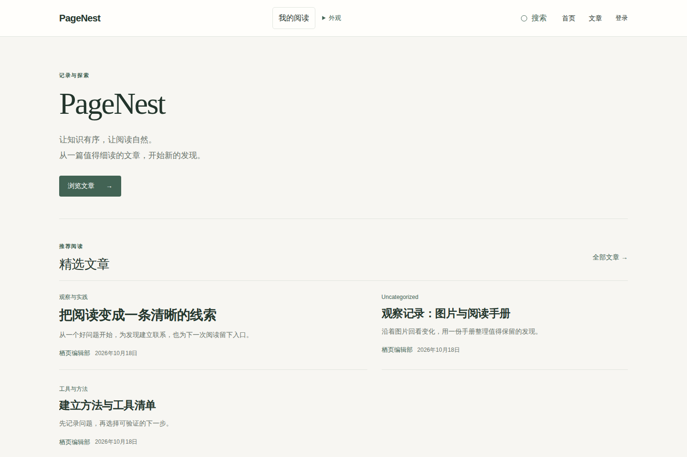

<strong>面向技术笔记、专题与长文阅读的独立 WordPress 主题。</strong> A reading-focused WordPress theme for technical notes and thoughtful writing.

  
  
  

<a href="#开始使用">开始使用</a> · <a href="docs/SHOWCASE.md">效果与设计</a> · <a href="docs/index.md">文档</a> · <a href="docs/USAGE.md">安装指南</a> · <a href="CHANGELOG.md">更新记录</a>

> 本文档对应 **1.4.0-rc.1 源码候选**，尚未公开发行或部署。正式安装请使用仓库 **Releases** 中已发行版本及其随包文档。

## 为内容组织，也为持续阅读

PageNest 把首页专题、文章目录和阅读设置放在同一套克制的界面中。站长用 WordPress 原生自定义器组织内容；读者按自己的节奏浏览专题、定位章节、调整正文的字号与宽度。

主题无需父主题，也不要求安装 Companion。已有文章、菜单和媒体仍由 WordPress 管理，启用主题不会导入演示内容。

## 实际效果

_合成内容的首页预览。更多阅读界面、明暗模式与设计说明见[效果与设计](docs/SHOWCASE.md)；演示图片不随安装自动导入。_

## 你能用它做什么

- **组织一个有入口的首页。** 设置介绍、专题、作者与精选内容，选择卡片或紧凑列表；未配置的模块自然留空。
- **读长文时知道自己在哪里。** 分层目录显示当前位置，分支可折叠，手机目录默认收起；没有小标题时仍能跳至正文。
- **让阅读适合当前设备。** 响应式页面、本机字号与正文宽度设置、暖纸和深色正文配色；偏好保存在当前浏览器。
- **建立自己的视觉。** 配色、字体尺寸、行高、间距和宽度集中配置；区块编辑器正文预览沿用相同视觉设置。
- **帮助读者发现下一篇。** 分类归档、搜索摘要与排序、相关文章和 WordPress RSS；搭配 Companion 可获得系列筛选与公开工具建议。
- **保留完整的站点外观。** 文章、页面、搜索、404、原生评论、密码文章、登录背景、导航与页脚都有对应模板或设置。

**1.3.0 已提供：** 全站浅色／深色／跟随系统，以及文章、专题、工具的独立布局预设；逐篇覆盖只改变展示。相关操作见[使用指南](docs/USAGE.md#全站明暗与页面布局)。

## 开始使用

需要 **WordPress 6.0+、PHP 8.0+**。

1. 从 仓库页面的 **Releases** 下载 `pagenest-版本号.zip` 安装附件。
2. 在后台 **外观 → 主题 → 安装主题 → 上传主题** 安装并启用。
3. 在 **外观 → 菜单** 分配 “全站主导航”，在 “站点身份” 设置标题与 Logo。
4. 打开 **外观 → PageNest**，进入自定义器配置首页、专题、作者与视觉，预览后发布设置。

请选择发行安装包；GitHub 的 Source code ZIP 用于查看源码。图片由使用者自行上传并确认使用权。完整设置、升级和阅读行为见[使用指南](docs/USAGE.md)。

## PageNest 与 Companion 如何搭配

| 组件                   | 主要职责                                                             | 是否必需               |
| ---------------------- | -------------------------------------------------------------------- | ---------------------- |
| **PageNest**           | 首页、模板、目录、视觉、阅读偏好与布局                               | 可独立使用             |
| **PageNest Companion** | 段落评论、章节导航、点赞，以及可选的搜索、分享、账号、导览与媒体功能 | 按需安装和启用         |
| **独立扩展**           | 经验政策、具体工具或其他业务实现                                     | 按需接入，不随主题提供 |

主题提供外观与扩展位置；Companion 管理功能、数据和权限。更换主题时，互动数据仍由插件维护。

## 文档与参与

从[文档导航](docs/index.md)按目标查找：

- [使用指南](docs/USAGE.md)：安装、首页编排、阅读设置、明暗、布局与升级。
- [效果与设计](docs/SHOWCASE.md)：真实合成站截图、设计取舍及功能范围。
- [扩展接口](docs/EXTENDING.md)：设置键、视觉变量与阅读布局接入。
- [贡献指南](CONTRIBUTING.md)：本地开发、格式和检查。
- [发行指南与问题反馈](docs/RELEASING.md)：CI、安装包、Release 和反馈所需信息。

采用 **[GPL-2.0-or-later](LICENSE)**。代码与随附合成演示图版权归 PageNest Contributors（2026）所有；使用者上传的站点图片与媒体不随主题分发。
