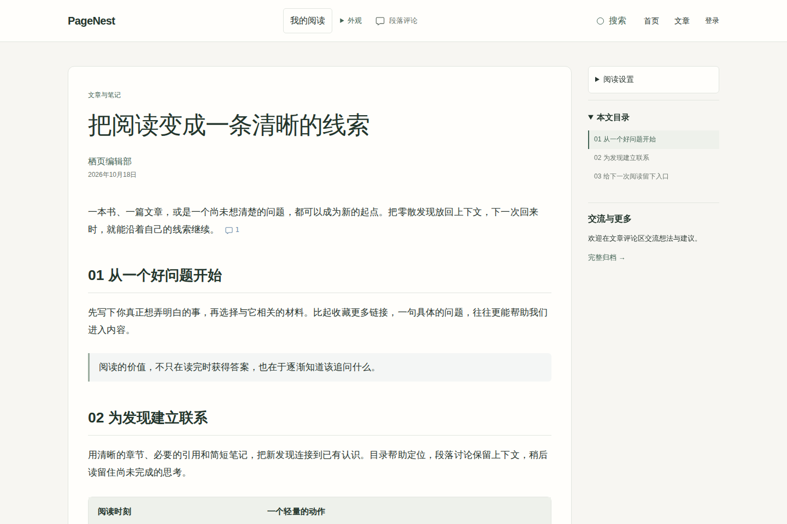
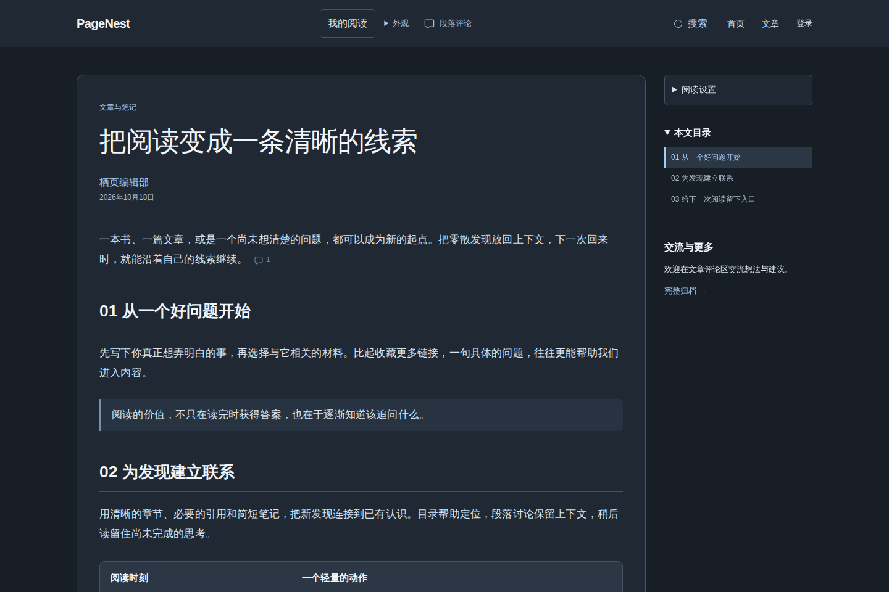
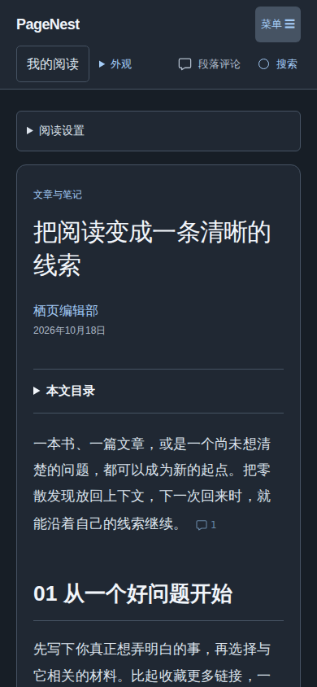
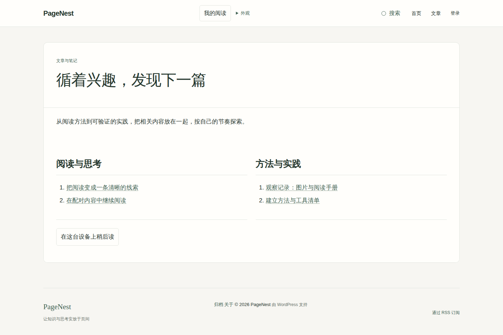

# 效果与设计

PageNest 为首页发现、专题浏览和长文阅读提供连贯的外观。以下使用合成内容展示产品；**1.3.0-rc.1 是尚未正式发行的候选**，全站明暗和布局预设属于候选能力。截图来自独立合成 WordPress 站点，搭配 Companion 1.6.0-rc.1；顶栏 “我的阅读” 和段落评论由 Companion 提供。

## 首页先给读者一个入口

介绍、专题、作者与精选内容由站长选择，文章列表可使用卡片或紧凑布局。首页没有自动导入的数据；未设置的部分不要求填满。

[首页与站点外观配置](USAGE.md#首页与站点外观)

## 为长文保留稳定的阅读节奏

正文优先，目录和相关文章作为辅助。目录保留标题层级和当前位置，分支可折叠；窄屏上默认收起，让读者先看到文章。字号、宽度和正文配色由本机阅读设置调整，长表格与代码仍可横向查看。

全站外观与正文配色是两项独立设置：站长指定默认浅色、深色或跟随系统，访客可以在当前浏览器覆盖；正文仍可以单独使用暖纸或暗色。设置不会同步到账户。

[阅读设置](USAGE.md#阅读与评论) · [全站明暗与页面布局](USAGE.md#全站明暗与页面布局)

## 按页面用途安排空间

文章提供标准、专注与宽版；专题提供标准、概览与宽版；工具提供标准、工作区与紧凑布局。站长可以设定默认值，也可逐篇覆盖。布局只改变展示，页面用途不会注册工具、启用业务或改变访问权限。

_专题概览的布局由主题提供，图中分组与链接使用 Companion 独立内容导览。_

[布局与配置迁移](USAGE.md#全站明暗与页面布局) · [开发接入](EXTENDING.md)

## 设计中的取舍

- **阅读与导航有主次。** 标题和正文决定页面节奏，目录用于定位；手机不强制展示完整侧栏。
- **沿用 WordPress 的内容管理。** 配置中心连接原生自定义器，样板需要作者手动插入；启用主题不创建文章、页面或媒体。
- **主题与功能分开。** 主题提供视觉与布局；Companion 提供互动、内容发现及可选媒体功能，数据和权限在插件中维护。
- **尊重已经保存的设置。** 自定义颜色与尺寸继续优先，视觉 JSON 只迁移明确列出的配置，不携带站点正文或账号。

图中素材均为合成内容，不包含生产站点配置。桌面和手机尺寸展示属于浏览器模拟，不代表实体手机验收。仓库展示图不进入主题安装 ZIP；根目录 `screenshot.png` 是 WordPress 标准主题预览。

返回[文档导航](index.md)或[项目首页](../README.md)。
